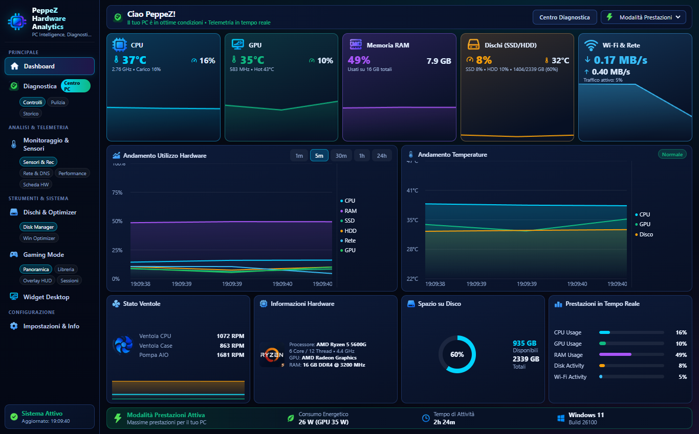
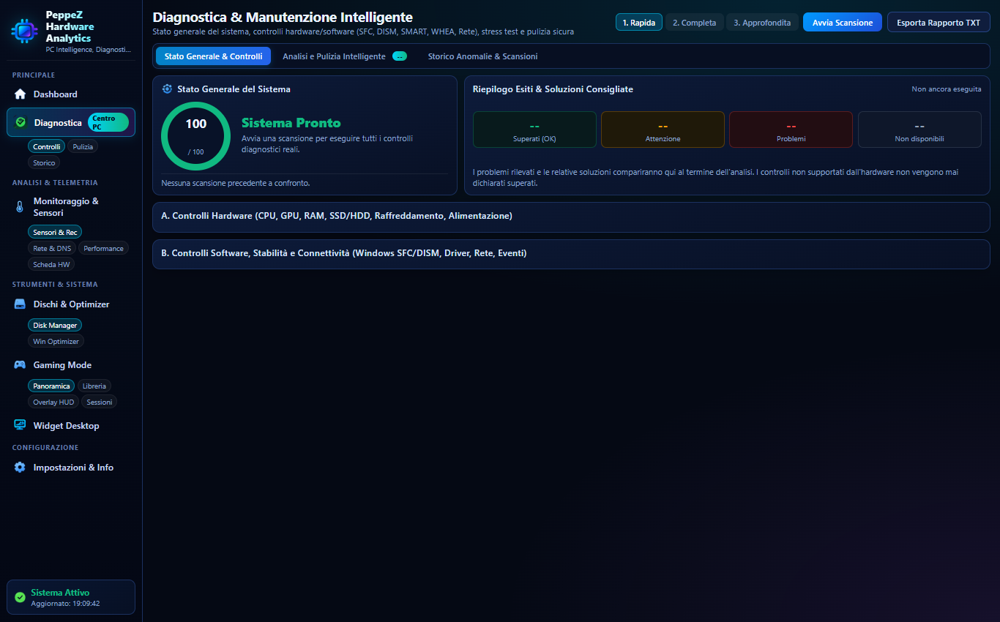
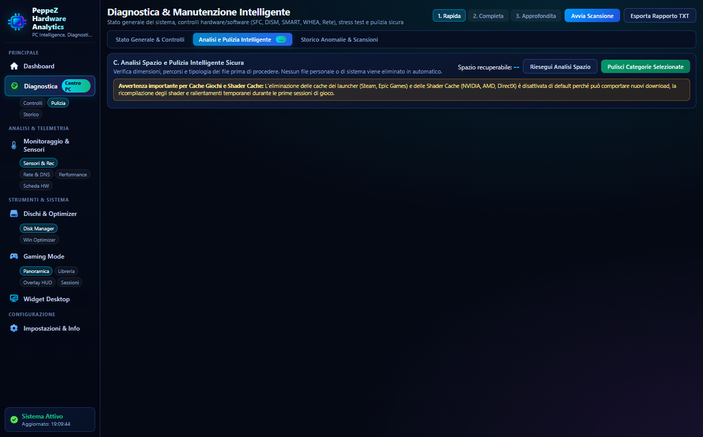
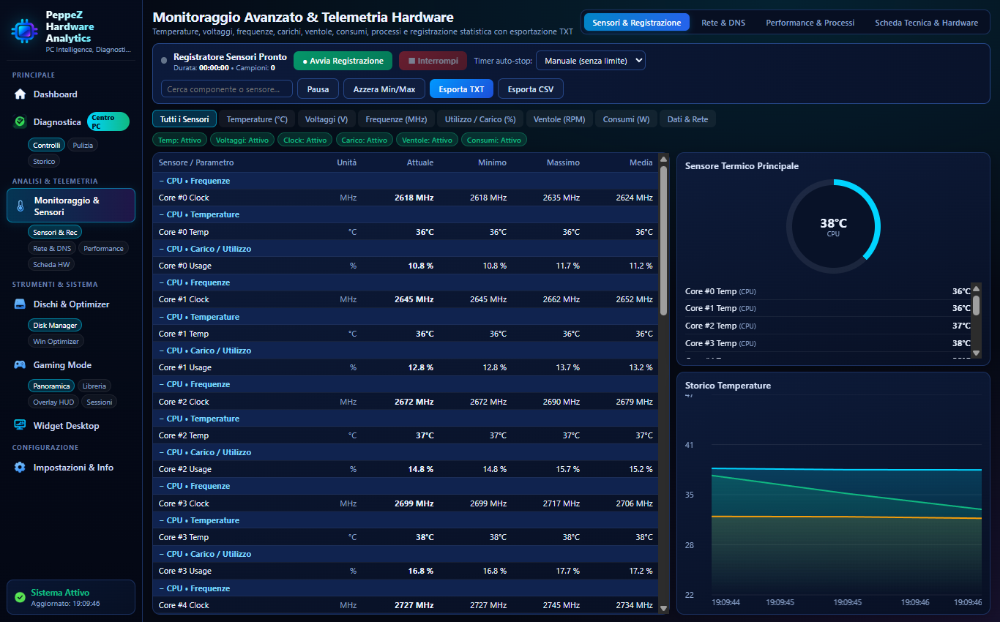
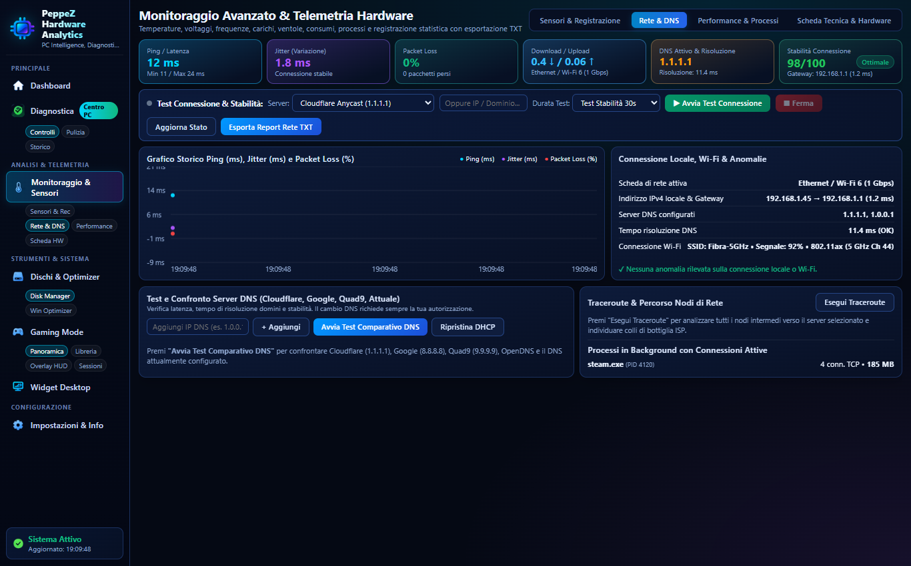
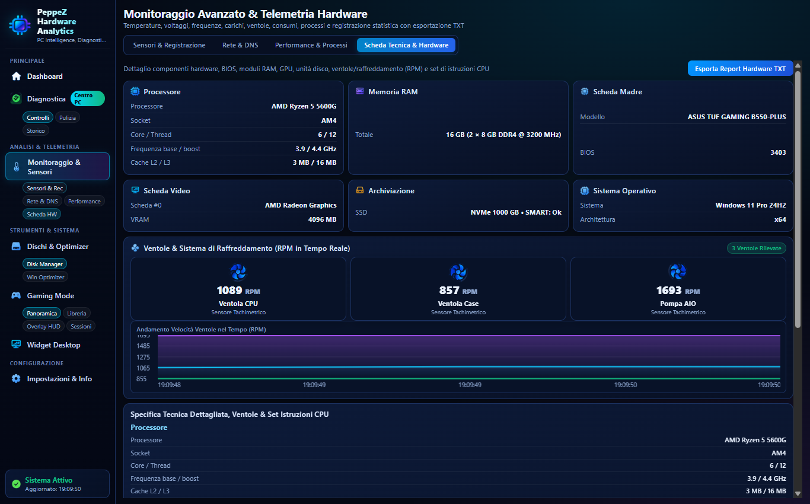
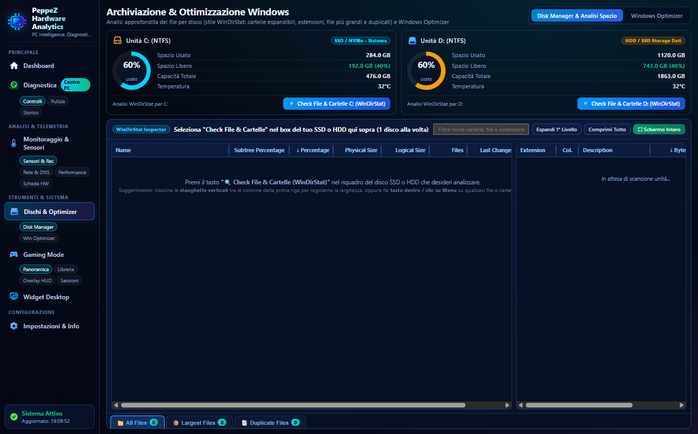
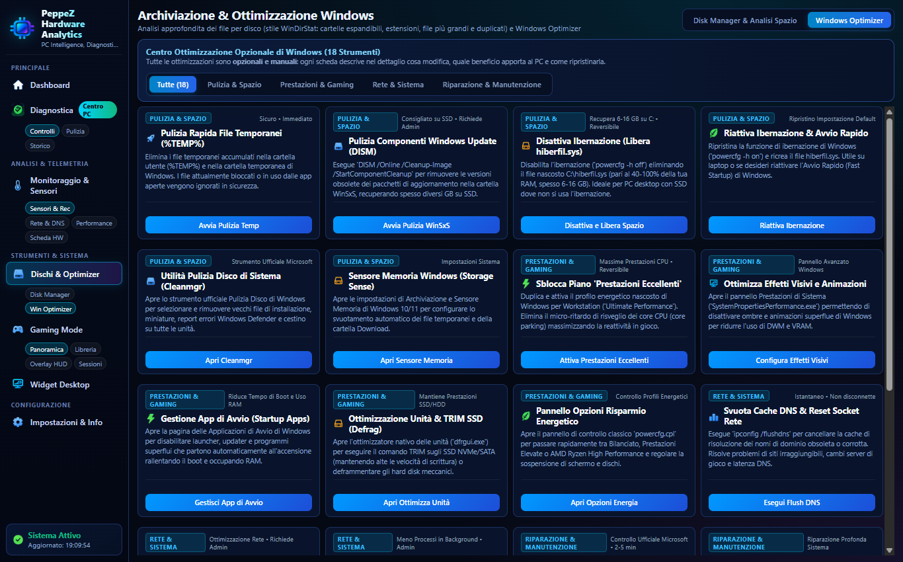
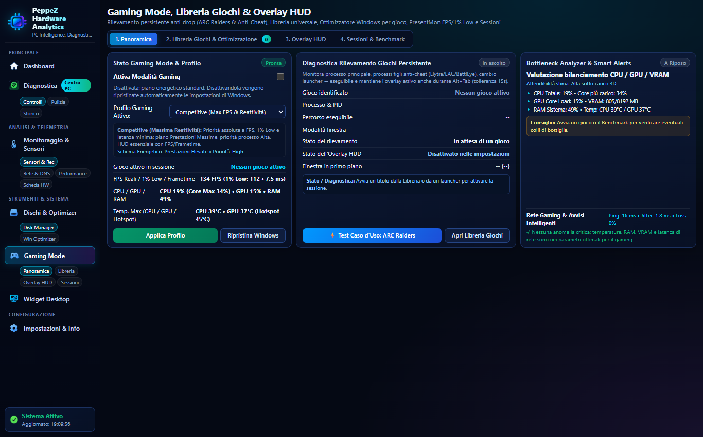
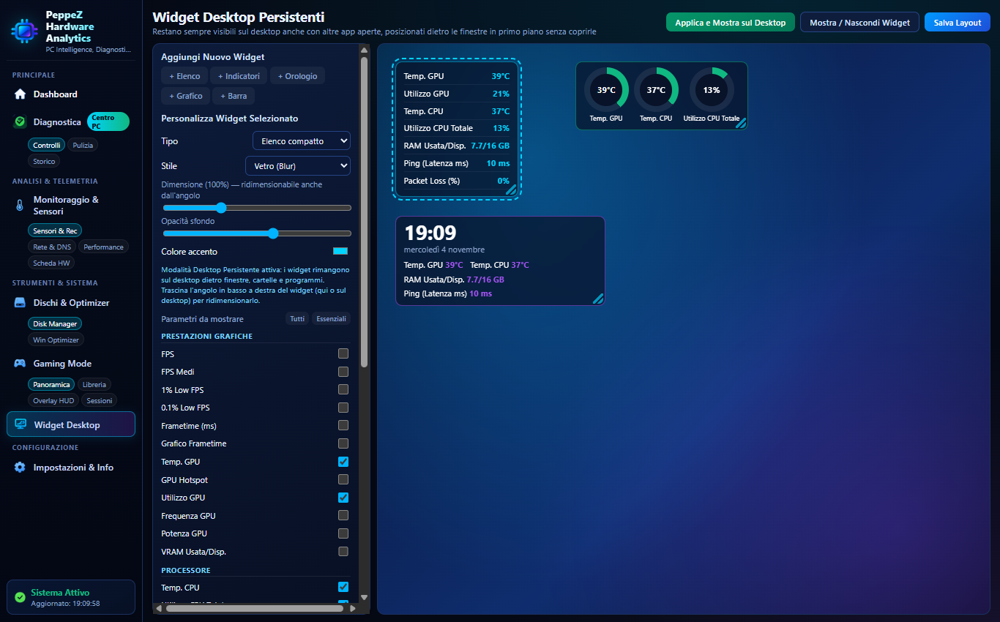

<div align="center">


# PeppeZ Hardware Analytics

**Advanced PC Monitoring, Hardware Diagnostics, WinDirStat Disk Space Analyzer & Gaming Optimizer for Windows**

[](https://github.com/gblandino04-code/PeppeZ-Hardware-Analytics/releases)
[](https://github.com/gblandino04-code/PeppeZ-Hardware-Analytics)
[](LICENSE)
[](https://www.electronjs.org/)
[](https://nodejs.org/)

<p align="center">
  <b>PeppeZ Hardware Analytics</b> è una suite all-in-one open-source progettata per monitorare in tempo reale lo stato dell'hardware del PC, eseguire diagnostiche approfondite con punteggio di salute, analizzare lo spazio su disco in stile <i>WinDirStat</i>, ottimizzare rete e DNS, e monitorare le performance nei videogiochi tramite telemetria PresentMon a basso livello.
</p>

[Funzionalità](#-funzionalità-principali) • [Galleria Schermate](#-galleria-schermate) • [Architettura & Sicurezza](#-architettura--gestione-sicura-dei-dischi) • [Installazione & Build](#-installazione-e-avvio) • [Licenza](#-licenza)

---

</div>

## 🌟 Funzionalità Principali

### 1. 🖥️ Dashboard Hardware Big Tech Compatta
* **Visualizzazione Completa a Colpo d'Occhio**: metriche istantanee per **CPU**, **GPU**, **RAM**, **Dischi (SSD/HDD)** e **Rete/Wi-Fi**.
* **Grafici in Tempo Reale**: andamento temporale dell'utilizzo percentuale e delle curve termiche.
* **Layout Ottimizzato**: tutti gli indicatori vitali rimangono visibili contemporaneamente in una singola schermata, senza dover scorrere verticalmente.
* **Supporto Multi-Sensore**: visualizzazione immediata di temperature (CPU package, GPU core, HotSpot, dischi), frequenze di clock, consumi in Watt e velocità delle ventole in RPM.

---

### 2. 🩺 Centro Diagnostica & Pulizia Intelligente
* **3 Livelli di Controllo**:
  * **Rapida**: verifica termica, integrità SMART dischi e carico di memoria.
  * **Completa**: controlli `SFC` / `DISM`, verifica stato driver PnP, analisi degli eventi BSOD (schermate blu/BugCheck) negli ultimi 30 giorni e stato degli aggiornamenti Windows.
  * **Approfondita**: stress test multi-core CPU con rilevamento del thermal throttling, test integrità celle RAM (pattern 0xAA/0x55) e benchmark I/O del disco.
* **Punteggio di Salute Dinamico (0-100)**: valutazione calcolata esclusivamente sui controlli realmente eseguiti, con confronto storico rispetto alle scansioni passate ed esportazione report in TXT.
* **Pulizia Intelligente con Protezione**:
  * Rimozione sicura di file temporanei, cache browser (Chrome, Edge, Firefox), cache launcher (Steam, Epic Games), shader cache (DirectX, NVIDIA, AMD), crash dump e miniature.
  * **Safety Window di 30 minuti**: non tocca mai file scritti o modificati di recente per evitare di interferire con installer o download attivi.
  * Conferma esplicita richiesta prima di qualsiasi cancellazione: nessun dato personale viene eliminato automaticamente.

---

### 3. 📊 Monitoraggio Sensori, Telemetria & Scheda Tecnica
* **Lettura Sensori a Basso Livello**: integrazione trasparente con **LibreHardwareMonitor** (server locale porta 8085) e driver **PawnIO** ring-0.
* **Tracciamento Dettagliato**:
  * Temperature di ogni singolo core CPU, GPU HotSpot e sensori termici NVMe.
  * Voltaggi / Tensioni operative (VCore, 12V, 5V, 3.3V).
  * Consumi energetici dedicati (CPU Package PPT, GPU TGP).
  * Velocità ventole tachimetriche (RPM).
* **Registratore Dati di Telemetria**: avvio/stop della registrazione su intervalli personalizzati, calcolo automatico di Min, Max e Media, ed esportazione dei campioni in formato **TXT** o **CSV**.
* **Scheda Tecnica Dettagliata**: riassunto delle specifiche hardware del PC (processore, architettura, motherboard, BIOS, memorie DIMM, display e controller storage).

---

### 4. 💽 WinDirStat Disk Space Analyzer
* **Analizzatore Gerarchico ad Albero**: scansione ultra-rapida di una singola unità disco alla volta con esplorazione interattiva cartella per cartella.
* **Calcolo Reale su Disco (Cluster Size)**: visualizzazione precisa delle dimensioni reali e dell'ingombro fisico su cluster (4 KB).
* **Ripartizione Estensioni & Colori**: elenco esaustivo delle tipologie di file presenti sul disco con legenda cromatica dedicata (UCAS, PAK, DLL, EXE, MP4, ISO, ecc.).
* **Top File più Grandi & Rilevamento Duplicati**:
  * Elenco ordinato dei file più pesanti per individuare immediatamente cosa occupa spazio.
  * Ricerca duplicati basata su hash SHA-1 rapido per blocchi, attivabile solo manualmente.
* **Integrazione Esplora Risorse**: apertura diretta della cartella, Prompt dei Comandi o PowerShell nella cartella selezionata, apertura finestra Proprietà di Windows e spostamento sicuro nel Cestino.

---

### 5. 🌐 Suite Rete & Benchmark DNS
* **Telemetria Live**: misurazione continua di **Ping**, **Jitter** e **Packet Loss** con frequenza di aggiornamento a 1 secondo.
* **Benchmark Server DNS**: test simultaneo di latenza per i principali resolver (Cloudflare, Google, Quad9, OpenDNS, AdGuard, DNS locale) con indicazione del server più veloce.
* **Applicazione DNS a 1 Clic**: possibilità di impostare direttamente i server DNS primario e secondario sulla scheda di rete attiva di Windows senza aprire il Pannello di Controllo.
* **Traceroute & Diagnostica**: rilevamento degli hop di rete per analizzare problemi di routing e latenza verso server specifici.

---

### 6. 🎮 Gaming Mode, Overlay HUD & Analisi Bottleneck
* **Rilevamento Automatico dei Giochi**: monitoraggio in background dei processi in primo piano con supporto per oltre 850 giochi noti e librerie Steam, Epic Games ed Xbox.
* **Telemetria Prestazioni PresentMon / ETW**:
  * Frame Rate istantaneo (FPS), FPS Medi, FPS Minimi, FPS Massimi.
  * Metriche di fluidità competitiva: **1% Low** e **0.1% Low**.
  * Tempo di rendering del frame (**Frame Time**) e grafico di andamento temporale.
* **Calcolo del Bottleneck Hardware**: algoritmo diagnostico che confronta carico e frequenze per indicare se il sistema è limitato dalla CPU (CPU Bottleneck) o dalla GPU (GPU Bottleneck).
* **Sessioni di Gioco Registrate**: salvataggio automatico delle statistiche di ogni sessione giocata con calcolo delle temperature massime ed esportazione report.
* **Ottimizzatore Windows per il Gaming**: attivazione rapida della Game Mode, disattivazione GameDVR/registrazione in background e supporto GPU ad alte prestazioni.

---

### 7. 🪟 Widget Desktop HWND_BOTTOM
* **Monitoraggio Sempre Attivo**: visualizzazione delle metriche hardware (CPU, GPU, RAM, Dischi, Rete) direttamente sul Desktop di Windows.
* **Posizionamento Nativo Posteriore**: il widget rimane agganciato al livello di sfondo (`HWND_BOTTOM`), rimanendo costantemente visibile dietro le cartelle e i programmi aperti senza mai sovrapporsi né disturbare il lavoro.
* **Completamente Personalizzabile**: selezione dei parametri da visualizzare, regolazione opacità, colore e dimensione.

---

## 📸 Galleria Schermate

### Dashboard Principale
> *Panoramica completa e compatta di tutte le metriche hardware, grafici in tempo reale di utilizzo e temperature.*



---

### Centro Diagnostica & Integrità PC
> *Scansione diagnostica con punteggio di salute su scala 100, controlli driver, eventi BSOD e verifica storage SMART.*



---

### Pulizia Intelligente di Sistema
> *Analisi e pulizia di cache browser, shader compilati, file temporanei e log con protezione attiva sui file in uso.*



---

### Monitoraggio Sensori & Telemetria Live
> *Visualizzazione e registrazione in tempo reale di temperature, frequenze, consumi in Watt e tensioni operative.*



---

### Rete & Benchmark Server DNS
> *Misurazione continua di ping, jitter e perdita pacchetti, unita al benchmark comparativo dei server DNS.*



---

### Scheda Hardware Completa
> *Rilevamento e specifiche dettagliate di motherboard, processore, controller video, RAM e memorie di massa.*



---

### WinDirStat Disk Manager
> *Mappa gerarchica dello spazio su disco, analisi per estensione file e identificazione dei file più pesanti.*



---

### Windows System Optimizer
> *Strumenti mirati di manutenzione del sistema operativo, ottimizzazione dello stack di rete e pulizia componenti.*



---

### Gaming Mode & Telemetria PresentMon
> *Rilevamento del gioco attivo, metriche FPS, 1% Low, calcolo del collo di bottiglia e storico sessioni.*



---

### Configurazione Widget Desktop
> *Gestione dei widget trasparenti persistenti da mantenere sul desktop sotto tutte le altre finestre.*



---

## 🛡️ Architettura & Gestione Sicura dei Dischi

A partire dalla versione 2.0.0, l'architettura di accesso al file system è stata integralmente revisionata per garantire che **PeppeZ Hardware Analytics non interferisca mai con download, aggiornamenti o installazioni di altre applicazioni** (come installer NSIS, MSI o per-utente):

1. **Livello di Esecuzione `highestAvailable`**: l'applicazione si adatta al contesto dell'utente. Se avviata da un utente standard, opera con normali permessi utente senza richiedere forzatamente elevazioni UAC superflue; se avviata come amministratore, attiva le funzionalità hardware kernel avanzate.
2. **Accesso Non Esclusivo ai File (Shared Handles)**: tutte le funzioni di lettura dimensioni e hash calcolano le impronte con flag di condivisione aperti e rilasciano immediatamente i descrittori di file in blocchi `finally` garantiti, evitando qualsiasi lock esclusivo (`EBUSY` / `ERROR_SHARING_VIOLATION`).
3. **Esclusione Automatica dei Percorsi di Installazione**: il modulo di analisi dello spazio e ricerca duplicati esclude a priori:
   - Cartelle temporanee utente e di sistema (`%TEMP%`, `AppData\Local\Temp`, `Windows\Temp`).
   - Directory di installazione di app utente e staging (`AppData\Local\Programs`, `SquirrelTemp`, `Package Cache`, `Windows\Installer`).
   - File di download parziale o lock (`*.tmp`, `*.part`, `*.crdownload`, `*.download`, `*.pending`).
4. **Safety Window di 30 Minuti**: la pulizia file non elimina mai elementi creati o modificati negli ultimi 30 minuti, proteggendo setup in esecuzione e file in corso di download.
5. **Benchmark I/O Isolato**: i test di scrittura temporanea su disco utilizzano una cartella dedicata con nomi casuali univoci e rimozione automatica immediata in `finally`.

---

## 🚀 Installazione e Avvio

### Requisiti di Sistema
* **Sistema Operativo**: Windows 10 o Windows 11 (64-bit).
* **Node.js**: versione 18.x o successiva (LTS consigliata per l'esecuzione da sorgente).

### Download Precompilato
1. Scarica l'ultimo file di installazione da [GitHub Releases](https://github.com/gblandino04-code/PeppeZ-Hardware-Analytics/releases).
2. Esegui il programma di installazione `PeppeZ Hardware Analytics Setup 2.0.0.exe`.
3. Completa la procedura guidata e avvia l'applicazione.

### Esecuzione dai Sorgenti
```powershell
# Clona il repository
git clone https://github.com/gblandino04-code/PeppeZ-Hardware-Analytics.git
cd PeppeZ-Hardware-Analytics

# Installa le dipendenze
npm install

# Avvia l'applicazione in modalità sviluppo
npm start
```

### Compilazione del Pacchetto Installer (.exe)
```powershell
# Compila il pacchetto di installazione NSIS autonomo
npm run dist
```
L'eseguibile di installazione verrà generato all'interno della cartella `dist/`.

---

## 🧰 Stack Tecnologico

* **Frontend**: HTML5, CSS3 moderno con supporto responsive, Canvas nativo per grafici termici e di carico in tempo reale.
* **Desktop Framework**: [Electron 31](https://www.electronjs.org/) con isolamento del contesto (`contextIsolation`) e IPC bidirezionale tramite preload script sicuro.
* **Telemetria Hardware**: [systeminformation](https://systeminformation.io/) e [LibreHardwareMonitor](https://github.com/LibreHardwareMonitor/LibreHardwareMonitor) REST Web API.
* **Driver Hardware Ring-0**: [PawnIO](https://github.com/namazso/PawnIO.Setup) per la lettura a basso livello di registri MSR, sensori Super I/O e curve termiche CPU/VRM.
* **Metriche Gaming**: [PresentMon](https://github.com/GameTechDev/PresentMon) via Event Tracing for Windows (ETW) con acquisizione ad alta precisione dei frame.

---

## 📄 Licenza

Questo progetto è rilasciato sotto licenza open-source [MIT](LICENSE).

```text
Copyright (c) 2026 PeppeZ (gblandino04-code)
```
Sviluppato con passione per offrire uno strumento di monitoraggio e diagnostica hardware potente, affidabile, compatto e sicuro per l'ecosistema Windows.
